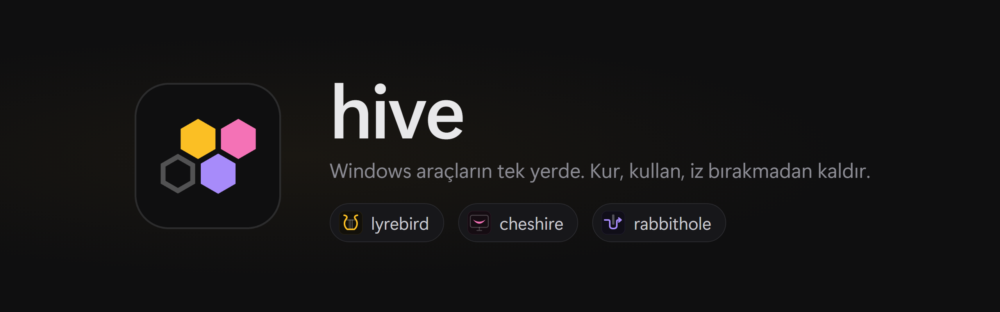
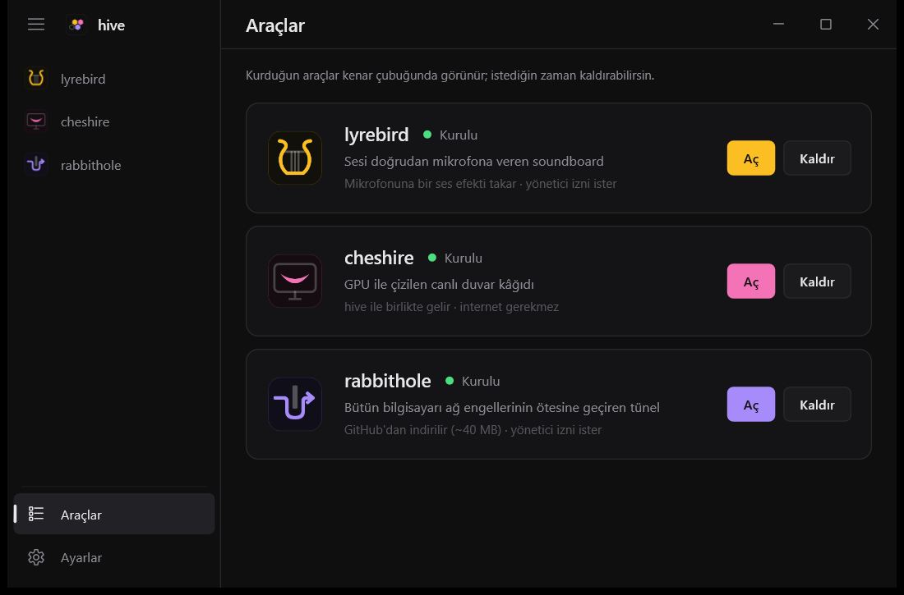
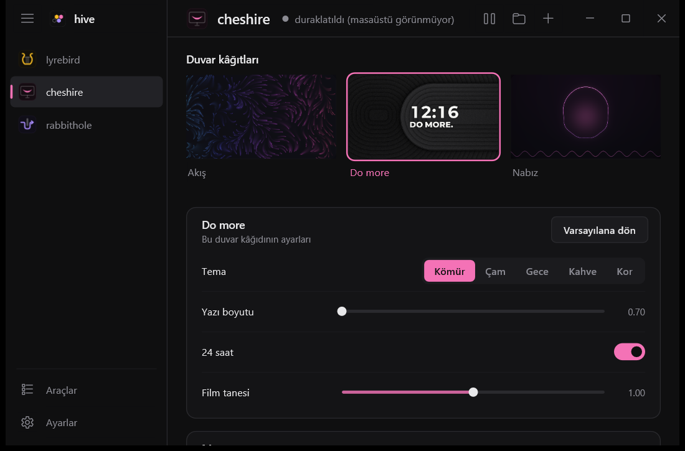

<p align="center">
  
</p>

<p align="center">
  <a href="https://github.com/matrixdurden/hive/releases/latest"></a>
  
  
  <a href="LICENSE"></a>
</p>

<p align="center"><a href="README.md">English</a> · <b>Türkçe</b></p>

<br>

## Kurulum

PowerShell'e yapıştır:

```powershell
irm https://github.com/matrixdurden/hive/raw/main/install.ps1 | iex
```

Yönetici izni gerekmez. Sonrasında winloom yeni sürümleri kendisi indirir, doğrular ve bir sonraki açılışında kurar (Ayarlar'dan hemen de kurulur, otomatik güncelleme kapatılabilir).

## Araçlar

Bütün araçlar winloom ile gelir: **Araçlar** sayfasından istediğini açarsın, açtığın her araç kenar çubuğunda ve Başlat menüsünde kendi adıyla görünür. "Pil" diye aratınca winloom o araçta açılır.

| | | |
|:---:|---|---|
|  | **Blast** | Sesi doğrudan mikrofona veren soundboard. Sanal mikrofon kurmaz; Discord, oyunlar, OBS, mikrofonu dinleyen her uygulama duyar. Myinstants'ta ses ara (kulaklıkta dinle, tek tıkla ekle); bilgisayarda az önce çalan son 10 saniyeyi kısayolla (`Ctrl+Alt+L`) listeye ekle. |
|  | **Duvar kâğıdı** | Masaüstü ikonlarının arkasında GPU ile çizilen canlı duvar kâğıtları. Tam ekranda ve pilde kendiliğinden durur. |
|  | **VPN** | Bütün bilgisayarı ağ engellerinin ötesine geçiren VPN: kendi sunucun üzerinden ya da sunucusuz DPI modunda. [Ayrı depo](https://github.com/matrixdurden/rabbithole). |
|  | **Pil** | Dizüstü için üç vites: prizde, dışarıda bir iki saat, hayatta kalma. Şarj takılıp çıkınca kendi geçer, pildeyken ekran kartını uyutur, her vitesin gerçekte kaç saat gittiğini öğrenir. |
|  | **Ses aygıtları** | Ses çıkışları ve girişleri tek listede: tıkladığın varsayılan olur. Tek tuşla sonraki çıkışa (`Ctrl+Alt+O`), sonraki girişe (`Ctrl+Alt+I`) geçer ya da mikrofonu susturur (`Ctrl+Alt+K`). Kulaklık kopunca da müzik laptop hoparlöründen devam etmez, durur. |
|  | **Dock** | Windows görev çubuğunun yerine, Windows 11 görünümünde bir dock: sabitlediğin ve açık uygulamalar yüzen tek bir çubukta, ucunda Wi-Fi, ses, pil ve saat. İmlecin altındaki simgeler büyür, dikkat isteyen uygulama zıplar, üstünde durunca pencerelerinin canlı önizlemesi açılır, sürükleyerek sıralarsın. Hep ekranda durur, büyütülen pencereler onun üstünde biter; tam ekran oyunlarda hiç görünmez. İmleci sol üst köşeye sertçe götürünce bütün pencereler (Win+Tab), sağ alt köşeye götürünce masaüstü açılır (ikisi de kapatılabilir). Win+1…9 uygulamaları dock sırasıyla açar; "Dock'a sabitle" sağ tık menüsünde. Kaldırınca görev çubuğu ve Başlat eski haline döner. |
|  | **Müzik** | Spotify'da çalan, dock'un solunda dock boyunda bir şeritte: kapak, şarkı, sanatçı, önceki / çal / sonraki ve tıklayıp atlayabildiğin ince bir ilerleme çizgisi. Karta tıklayınca açık Spotify penceresi öne gelir. Arka planı kapağın bulanık hali, kapağın rengi ya da dock gibi düz. Spotify uygulamasıyla da tarayıcıdan kurulan Spotify web uygulamasıyla da çalışır; Spotify'a giriş gerekmez. İstersen diğer oynatıcılar (tarayıcıda YouTube, ...) da görünür. |
|  | **Tıklayıcı** | Klasik otomatik tıklayıcı. Bir tuşa basılı tut (ya da aç/kapa modunda bir kez bas), imlecin olduğu yere sol, sağ ya da orta düğmeyle iki saniyede birden saniyede yüze kadar tıklar; bırakınca ya da belirlediğin sayıya gelince durur. Tuşu sen seçersin (başlangıçta `F6`). |

<table>
  <tr>
    <td width="50%"></td>
    <td width="50%"></td>
  </tr>
  <tr>
    <td align="center"><sub>Araçlar: aç, kapat</sub></td>
    <td align="center"><sub>Duvar kâğıdı: duvar kâğıtları ve ayarları</sub></td>
  </tr>
</table>

winloom İngilizce ve Türkçe konuşur; Windows'un görüntü dilini izler, Ayarlar'dan değiştirilebilir.

## İz bırakmaz

Bir aracı kapatınca açılırken yaptığı her şey geri alınır: dosyalar, kayıt defteri, mikrofon ayarları, hizmetler, PATH, kısayollar. Kapatmanın sonunda winloom bunları tek tek denetler; bir şey kalmışsa kapatma başarılı sayılmaz ve neyin kaldığını söyler.

winloom'ı kaldırmak (Ayarlar'dan ya da Windows'un **Uygulamalar** listesinden) önce açık bütün araçları aynı şekilde kapatır, sonra kendini.

```powershell
winloom --leftovers    # kapalı araçlardan kalan iz var mı
```

## Derleme

WSL'den Windows için çapraz derlenir (`x86_64-pc-windows-gnu`, mingw gerekir):

```sh
make build      # target/x86_64-pc-windows-gnu/release/winloom.exe
make install    # %LOCALAPPDATA%\Programs\winloom altına kur ve başlat
make release    # Cargo.toml'daki sürümle GitHub'da yayın
```

| Klasör | |
|---|---|
| [`merkez/`](merkez) | winloom.exe: pencere, tepsi, araçları açıp kapatma, güncelleme, kurulum |
| [`ortak/`](ortak) | Bütün araçların paylaştığı kod: çizim, arayüz parçaları, log, ağ, dil, araç sözleşmesi |
| [`araclar/<id>/`](araclar) | Her araca bir klasör: sayfası (`src/`), ikonu (`ikon/`), varsa motoru (`motor/`) |
| [`araclar/soundboard/motor/`](araclar/soundboard/motor) | Soundboard motoru; mikrofon efekti [`apo/`](araclar/soundboard/apo) içinde |
| [`araclar/wallpaper/motor/`](araclar/wallpaper/motor) | Duvar kâğıdı motoru ve [`.cheshire` formatı](araclar/wallpaper/motor/README.md#the-cheshire-format) |

Yeni araç eklemek: [ARAC-EKLEME.md](ARAC-EKLEME.md).

## Lisans

MIT
